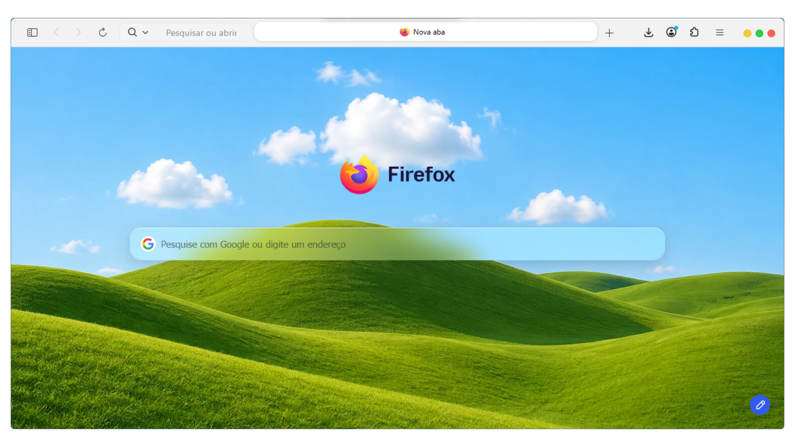
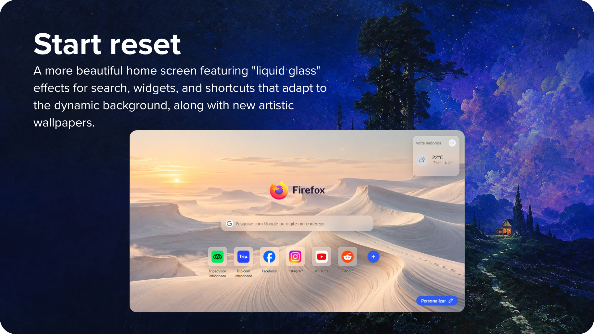
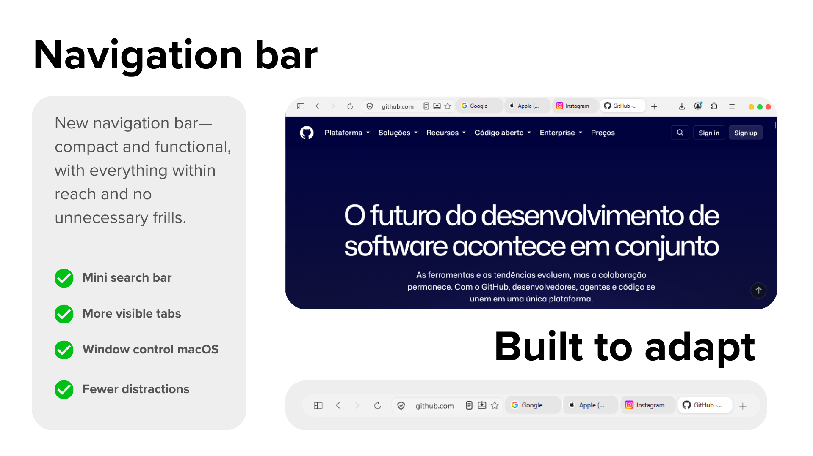
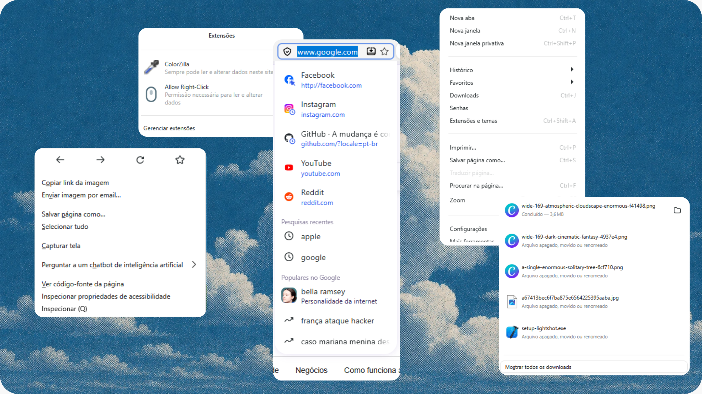

<!-- ==================== INTRODUCTION: THEME NAME ==================== -->

<h3 align="center">Safari Golden Gate</h3>

<!-- ==================== INTRODUCTION: MAIN TAGLINES ==================== -->

<h1 align="center">
  More room to explore.<br>
  More beauty in every detail.
</h1>

<br>

<!-- ==================== IMAGE 01: MAIN THEME PREVIEW ==================== -->

<p align="center">
  
</p>

<br>

<!-- ==================== INTRODUCTION: MAIN DESCRIPTION ==================== -->

<p align="left">
  A highly refined, premium CSS theme that transforms Firefox into an experience inspired by modern macOS Safari—preserving everything that makes Firefox powerful while bringing together functionality, beauty, and speed.
</p>

<br>

<!-- ==================== IMAGE 02: START RESET AND LIQUID GLASS ==================== -->

<p align="center">
  
</p>

<br>

<!-- ==================== ABOUT THE PROJECT: ORIGIN AND INSPIRATION ==================== -->

<p align="left">
  This project was created to improve the look and feel of the Firefox interface.<br>
  It was inspired by the <a href="https://github.com/vinceliuice/WhiteSur-firefox-theme">WhiteSur Firefox Theme</a>.
</p>

<br>

<!-- ==================== SECTION: WHY SAFARI? ==================== -->

<h1 align="left">Why Safari?</h1>

<!-- ==================== TEXT: WHY SAFARI? ==================== -->

<p align="left">
  Your browser is probably one of the tools you use the most.<br>
  Whether for work or play, <strong>looks matter</strong>—and that is why we decided to bring Safari's elegance to Firefox.
</p>

<p align="left">
  We set out to make the most of its visual language and thoughtful approach to design.<br>
  After all, Steve left a legacy.
</p>

<br>

<!-- ==================== IMAGE 03: NAVIGATION BAR ==================== -->

<p align="center">
  
</p>

<br>

<!-- ==================== SECTION: NEW WAYS TO CLICK ==================== -->

<h3 align="left">New ways to click</h3>

<!-- ==================== IMAGE 04: MENUS, SEARCH, AND DOWNLOADS ==================== -->

<p align="center">
  
</p>

<br>

<!-- ==================== HIGHLIGHT: DESIRE AND ADDITIONAL FEATURES ==================== -->

<h1 align="left">After this, the default just won't feel like enough.</h1>

<!-- ==================== LIST: ADDITIONAL FEATURES ==================== -->

- Consistent buttons throughout the interface.
- Cleaner Bookmarks, Library, and Settings views.
- Subtle animations that respect reduced-motion preferences.
- A stable, organized layout from the very first launch.

<br>

<!-- ==================== SECTION: COMPATIBILITY ==================== -->

<h1 align="left">Compatibility</h1>

<!-- ==================== TABLE: SUPPORTED ENVIRONMENT ==================== -->

| Component | Current compatibility |
|---|---|
| Browser | Firefox 158 or newer |
| Operating system | Windows 10 and Windows 11 |
| Appearance | Light theme |
| Project version | First public release |

<!-- ==================== NOTICE: FIRST RELEASE ==================== -->

> [!IMPORTANT]
> This is the first release of Safari Golden Gate. The project currently supports only Firefox's light theme. Other operating systems and appearance modes have not yet been officially tested.

<br>

<!-- ==================== SECTION: INSTALLATION ==================== -->
<h1 align="left">Installation</h1>

<!-- TEXT: MANUAL INSTALLATION NOTICE -->
> [!NOTE]
> This first release uses a manual installation process designed for Windows. A dedicated installer is planned for a future release, making the entire process faster and automatic.

<!-- SUBHEADING: BEFORE YOU BEGIN -->
<h2 align="left">Before you begin</h2>

You will need:

- Firefox 158 or newer;
- Safari Golden Gate downloaded and extracted to a folder;
- A few minutes to configure your active Firefox profile.

> [!WARNING]
> Close Firefox completely before copying, replacing, or removing profile files. Never delete your entire profile folder: it also contains your bookmarks, history, extensions, and other personal data.

<!-- SUBHEADING: STEP 1 -->
<h2 align="left">1. Download Safari Golden Gate</h2>

Download the latest version from this repository's **Releases** section and extract the ZIP file. Inside the extracted folder, you will find the theme files, recommended settings, and optional wallpapers.

<!-- SUBHEADING: STEP 2 -->
<h2 align="left">2. Enable CSS theme support</h2>

1. Open Firefox and enter `about:config` in the address bar.
2. Accept the warning to continue.
3. Search for `toolkit.legacyUserProfileCustomizations.stylesheets`.
4. Set the preference to `true`.

This option allows Firefox to load the `userChrome.css` and `userContent.css` files used by the theme.

<!-- SUBHEADING: STEP 3 -->
<h2 align="left">3. Find the correct Firefox profile</h2>

1. Enter `about:support` in the address bar.
2. Locate **Profile Folder**.
3. Click **Open Folder**.
4. Once the folder is open, close Firefox completely.

If you use more than one profile, this method ensures that the theme is installed in the exact profile that was open.

<!-- SUBHEADING: STEP 4 -->
<h2 align="left">4. Create a backup</h2>

Before installing:

- If a folder named `chrome` already exists, rename it to `chrome.backup`.
- If a file named `user.js` already exists, create a copy named `user.js.backup`.

This makes it easy to restore any previous customization.

<!-- SUBHEADING: STEP 5 -->
<h2 align="left">5. Install the interface</h2>

Copy Safari Golden Gate's `chrome` folder into the root of the Firefox profile folder you opened earlier.

When finished, the structure should look like this:

```text
your-firefox-profile/
└── chrome/
    ├── userChrome.css
    ├── userContent.css
    └── ThemeCore/
        └── theme.css
```

> [!IMPORTANT]
> Avoid creating a duplicated path such as `chrome/chrome`. The `userChrome.css` file must be located directly inside the first `chrome` folder.

<!-- SUBHEADING: STEP 6 -->
<h2 align="left">6. Apply the recommended settings</h2>

The project's `configuration` folder contains a `user.js` file prepared for the theme.

- If your profile **does not have** a `user.js` file, copy `configuration/user.js` to the root of the profile.
- If your profile **already has** a `user.js` file, do not replace it. Add only the preferences below to your existing file:

```javascript
user_pref("toolkit.legacyUserProfileCustomizations.stylesheets", true);
user_pref("browser.tabs.drawInTitlebar", true);
user_pref("browser.uidensity", 0);
user_pref("browser.newtabpage.activity-stream.newtabWallpapers.enabled", true);
user_pref("browser.newtabpage.activity-stream.newtabWallpapers.customWallpaper.enabled", true);
user_pref("browser.newtabpage.activity-stream.newtabWallpapers.customWallpaper.library.enabled", true);
```

The file must be placed in the root of the profile, alongside folders such as `chrome`, `extensions`, and `storage`.

<!-- SUBHEADING: STEP 7 -->
<h2 align="left">7. Install the optional wallpapers</h2>

The wallpapers included with the project are not enabled by default.

1. In the root of your profile, create a folder named `wallpaper` if it does not already exist.
2. Copy the project's `wallpapers/library` folder into it.
3. Confirm that the final path is `your-firefox-profile/wallpaper/library/`.
4. Open a new tab in Firefox, click **Customize**, and select the image you want.

<!-- SUBHEADING: STEP 8 -->
<h2 align="left">8. Restart and enjoy</h2>

Open Firefox again. Safari Golden Gate will load automatically in the configured profile.

On the first launch, you can still use Firefox's own **Customize Toolbar** option to choose which buttons you want to display. The theme automatically reorganizes the available controls while preserving its compact layout.

<!-- SUBHEADING: UPDATING -->
<h2 align="left">How to update</h2>

1. Download and extract the latest version of the theme.
2. Close Firefox completely.
3. Create a backup of the currently installed `chrome` folder.
4. Replace the old `chrome` folder with the new one.
5. Compare the preferences in the new `configuration/user.js` file with your current file, adding only what is missing.
6. Open Firefox again.

If you have customized the theme manually, save those changes before replacing the folder so they are not lost during the update.

<!-- SUBHEADING: UNINSTALLING -->
<h2 align="left">How to uninstall</h2>

1. Close Firefox completely.
2. Open the profile folder again.
3. Remove or rename the `chrome` folder installed by Safari Golden Gate.
4. If you created a backup, rename `chrome.backup` back to `chrome`.
5. Restore your `user.js.backup` file if the previous file was changed.
6. Remove the `wallpaper/library` folder only if you also want to delete the theme's wallpapers.
7. Open Firefox.

You do not need to delete or recreate your profile to remove the theme.

<!-- SUBHEADING: TROUBLESHOOTING -->
<h2 align="left">Troubleshooting</h2>

**The theme did not appear**

- Confirm that `toolkit.legacyUserProfileCustomizations.stylesheets` is set to `true`.
- Make sure you installed the files in the active profile shown in `about:support`.
- Confirm that the path is `chrome/userChrome.css`, with no second `chrome` folder in between.
- Close every Firefox window and process before opening it again.

**The wallpapers do not appear**

- Confirm that all three `newtabWallpapers` preferences are set to `true`.
- Make sure the images are inside `wallpaper/library` in the root of the profile.

**The interface looks different from the screenshots**

- Use Firefox's light theme; this first release does not yet officially support dark mode.
- Keep the default density by setting `browser.uidensity` to `0`.
- Firefox updates may change internal interface elements. Check Releases and Issues for recent fixes.

<br>

<!-- ==================== SECTION: SUGGESTIONS AND BUGS ==================== -->
<h1 align="left">Suggestions and bug reports</h1>

Found a problem or have an idea for improving Safari Golden Gate? [Open an Issue on GitHub](../../issues/new) or email [junior_martins15@icloud.com](mailto:junior_martins15@icloud.com).

When reporting a bug, please include whenever possible:

- Your Firefox version;
- Your Windows version;
- A screenshot;
- The steps required to reproduce the issue.

This information helps us understand and fix every detail more quickly.

<br>

<!-- ==================== SECTION: SUPPORT THE PROJECT ==================== -->
<h1 align="left">Support the project</h1>

If Safari Golden Gate has made your Firefox more beautiful and enjoyable to use, support its development by clicking **Star** at the top of this repository.

Your star helps more people discover the project and encourages new releases, improvements, and broader compatibility.

**Enjoying the theme? Give it a star and share Safari Golden Gate.**
